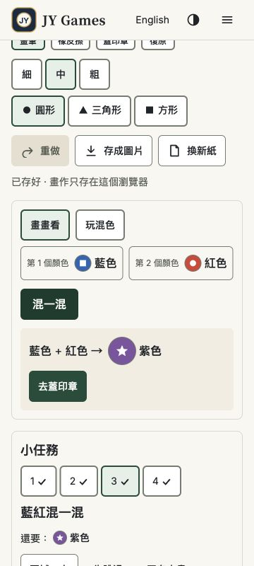

# 色彩塗鴉樂 D1–D4 第二輪複驗
日期：2026-10-18。產品端獨立複驗；原碼固定在 `06f580c45ab8b0f418f757c309f542f898f6d259`。

## 結論與開工順序
Claude 已修正並部署，不能再寫成「尚未開工」。本輪確認正常續玩及混色引導已修好；存檔仍有兩個可重現缺口，所以 **D1–D4 尚未全數通過，A3 暫不接正式首頁**。請 Claude 直接修下列 D3-R1、D4-R1，不必等開始確認；修好並附證據後接續 A3。負責人已授權「通過後加入正式首頁」，無須另提開始申請。餐廳維持暫停，不加回首頁。

| 項目 | 結果 |
|---|---|
| D1 正常續玩 | 通過：格子任務 3 混色後重整保留 grid／apply／任務 3；任務 4 蓋淺藍後重整保留那一筆及進度、選藍後蓋第二筆完成；離開至首頁再返回保留任務與模式。舊長筆畫相容性缺口列 D4-R1 |
| D2 混色結果與下一步 | 通過本輪範圍：360×800 繁中格子、英文自由畫及英文深色格子，結果色名＋動作可見，焦點仍在 Mix；鍵盤啟動後聚焦格子或畫紙。1019×667 自由畫在捲動完成後，畫紙 top 76／bottom 615、提示 top 627／bottom 651，頁首 bottom 57，全可見 |
| D3 壞檔保護 | 原始 JSON／未來 schema 備份、備份失敗改存替代鍵、持續失敗時重新載入、不可讀儲存等通過；**D3-R1 未通過：恢復備份能力後忽略替代畫作** |
| D4 寫讀邊界 | 2000 操作可讀、第 2001 操作安全拒絕；壓縮保留可見成品；新 4999／5000 點切段且順序及接點完全保留，均通過；**D4-R1 未通過：舊版合法長筆畫被當壞檔** |

原生 400% R5 沿用上一輪通過結論，本輪未重新宣稱完整 400%／六任務／八組主題矩陣已跑。iPhone／iPad Safari＋VoiceOver、觸控筆、孩子試玩仍未測，不冒稱通過；這些待實機項目不是新的開工批准流程。

## D3-R1／P2：備份恢復可寫時，續畫作品變成無入口的替代存檔
定位：[storage.ts:63](https://github.com/yangchijung/jytrvl-chess/blob/06f580c45ab8b0f418f757c309f542f898f6d259/src/doodle/storage.ts#L63)。

隔離儲存重現：
1. 主鍵 `jy.doodle.v1` 有未來 schema 的原文；備份鍵寫入失敗。
2. 載入後 target 為 `jy.doodle.v1.recovered`；畫一筆並保存。再次載入（備份仍失敗）可看見這一筆。
3. 讓備份恢復可寫，重新載入。第 63 行在檢查 ALT 前直接回 `blankSave()`＋主鍵。
4. 實測 visible 由 1 變 0。正常切換畫紙會把空白狀態存入主鍵；之後主鍵合法，載入永遠選它。

**原本的 raw 和替代畫作沒有被刪除**：前者已備份、後者仍留 ALT。但正常 UI 沒有回到 ALT 畫作的入口，孩子看到空白，也不能靠「下載舊存檔」取得 ALT 那張畫（該鈕下載的是原始 raw）。

修正要求：記錄並恢復目前有效的恢復工作階段；備份成功後仍先續用那張圖，或安全遷回主鍵並讀回驗證再切換。不要一律讓過期 ALT 蓋過更新的合法主鍵。驗收至少包含：失敗→ALT 畫圖→仍失敗重整→恢復可寫→重整→改模式／畫第二筆→再次重整，以及合法新主鍵與過期 ALT 共存時的選擇。

## D4-R1／P2（也影響 D1 舊檔遷移）：收緊點數後，合法舊檔被當成損壞
定位：[model.ts 的 MAX_PTS／validFreeOp／readSave](https://github.com/yangchijung/jytrvl-chess/blob/06f580c45ab8b0f418f757c309f542f898f6d259/shared/doodle/model.ts)。

修正前同為 schemaVersion 1 的單筆允許 1–4999 點。已用上一輪精確模型確認：2001 與 4999 點均為合法。新版 MAX_PTS=2000，`readSave` 先 `validSave` 才 `migrate`，因此這兩份舊檔都回 broken、備份後開空白；既有 migrate 只補 surface／active，不能救回。

**raw 有備份，並非永久刪除**；但是原來正常可開的作品更新後無法續畫，是升版回歸。

修正要求：讀取相容舊版合法資料，再無損正規化或保留相容讀取上限。新筆的寫入上限與舊檔讀取相容性要分開處理。若把舊筆切段，須維持座標順序、接點、顏色、粗細、橡皮擦、歷史 n 的 undo／redo 邊界；總段數超出 2000 時不得截畫。至少加入舊版 2000／2001／4999 點、redo 分支、遷移後再次保存重整測試。

## 獨立證據與限制
- [17 項隔離檢查結果](../test-results/doodle-four-recheck-2026-10-18/storage-boundary-results.json)：13 通過，4 失敗斷言對應上面 **2 個根因**，不是 4 個新問題。
- [可重跑腳本](../test-results/doodle-four-recheck-2026-10-18/recheck.mjs)：Node 24，從 repo 根目錄執行 `node --disable-warning=ExperimentalWarning docs/test-results/doodle-four-recheck-2026-10-18/recheck.mjs`；在上述 commit 原碼上得到本次結果。腳本是診斷清單，pass 欄是判斷，結束碼不代表全通過。只使用記憶體儲存，不注入正式瀏覽器 localStorage。
- [瀏覽器實測數值](../test-results/doodle-four-recheck-2026-10-18/browser-results.json)。只讀 rendered DOM／實際點擊、鍵盤、重整、導覽；未使用 app 隱藏狀態。混色後會平滑捲動，採完成後的位置判斷；中途位置不算裁切失敗。顏色按鈕點擊涉及瀏覽器自動捲動，本輪不另外宣稱精確「選色完全不捲」量測已通過。
- 正式站載入資產 `/assets/index-BRyKREmE.js`；UI 有本次新增結果動作。這不是獨立取得的正式部署 SHA。對應 commit 的 CI、Pages、Workers checks 均成功：[CI](https://github.com/yangchijung/jytrvl-chess/actions/runs/39130904898/job/117685675835)、[Pages](https://github.com/yangchijung/jytrvl-chess/runs/117685798079)、[Workers](https://github.com/yangchijung/jytrvl-chess/runs/117685784781)。
- 工程回報全套單元 240／240、doodle e2e 29／29、首頁共用 15／15；本輪未重新執行這些完整套件。獨立檢查補出工程案例未涵蓋的兩條恢復路徑。
- 已恢復 viewport override、主題跟隨系統及繁中。操作沿用先前驗收留下的測試畫紙，沒有清除使用者作品。

## 修好後直接做 A3
四項修正完整通過後，依既有授權把「色彩塗鴉樂／Color Doodle」接為第八款正式遊戲，同步更新首頁、玩法頁、導覽、SEO／robots／sitemap、遊戲數量與八款回歸。沿用 DESIGN.md：主要動作清楚、短文案、實色及既有共用樣式；首頁不放長教學文。正式入口接線完成再移除塗鴉預覽 noindex，其他原型維持原範圍。後續七款短練習順序不變。餐廳維持暫停。

請 Claude 回 Issue #7：修正 commit、上述兩條回歸結果、部署及預覽連結；同步 STATE／CHANGELOG／ACCEPTANCE 的工程與產品結果。不要把本輪交接當成 D1–D4 全部通過。
