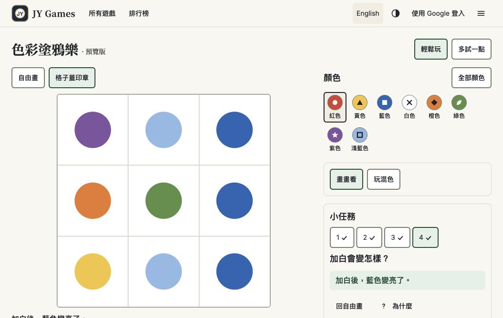

# 色彩塗鴉樂存檔複驗通過｜A3 直接開工
日期：2026-10-19（Asia/Taipei）。產品端獨立複驗原碼固定在 `7eae7f31c8c4050a8e2a50414ab6ad165695d931`。

## 結論
**D3-R1、D4-R1 通過本輪複驗。** 加上先前 D1 正常續玩與 D2 混色引導的通過結論，原四項問題及第二輪兩個存檔缺口可標記完成。不是宣稱所有裝置或所有 DC01–DC12 均已通過。

負責人已授權「通過後就讓 Claude 加入正式首頁」。**Claude 請直接做 A3 第八款接線，不必再等開始確認，也不用再派修已通過的項目。** 本輪查驗時首頁仍只有七款、塗鴉仍為 noindex 預覽；這份文件是驗收與開工交接，不代表 A3 已部署。餐廳維持暫停、不加入首頁。

## 本輪證據
| 範圍 | 獨立結果 |
|---|---|
| 上輪可重跑診斷 | 17／17 通過（上輪 13／17）：JSON／較新版本保護、備份失敗及恢復、2000／2001 操作、新長筆畫、舊長筆畫、任務續玩 |
| 新增存檔專項 | 24／24 通過：恢復後多畫一筆、改模式、全新模組再次載入；有效主檔與未搬回副本並存；搬回主鍵寫失敗／讀回不符；搬回標記寫失敗；舊筆畫 undo／redo 及保存後再次開啟 |
| 正式站操作 | 任務 4 混色、鍵盤蓋淺藍、顯示已存好、重整保留格子／進度／全部九格；蓋藍完成。復原使該格回空、重做恢復藍色。切英文再重整保留完成與畫紙，無存檔警告 |
| 目前首頁 | 7 個「開始玩」入口，塗鴉入口 0、餐廳入口 0。A3 尚未完成 |
| CI／部署 | 7eae7f3 的 build-and-test、Cloudflare Pages、Workers Builds 全部成功 |

### D3-R1 驗收
精確原碼、隔離記憶體儲存重跑：
- 備份失敗時原始主檔保持原文，另存位置可續畫。
- 備份恢復後，原圖完整搬回主存檔並讀回驗證，原始 raw 與另存副本仍保留。
- 搬回後再畫第二筆並切格子，重新載入仍是最新兩筆與格子模式，不被舊副本蓋回。
- 有效主檔與尚未搬回的其他副本共存：主檔優先，另一份透過 oldRaw 提供下載內容，兩者都保留。
- 主鍵寫失敗、寫後讀回不符時改在另存位置續畫；搬回標記寫失敗也不會讓有效主檔被蓋回。

這些是精確載入邏輯與輸出資料的隔離驗證；本輪沒有在正式瀏覽器注入壞檔或容量故障，也沒有獨立重跑錯誤提示的下載按鈕。

### D4-R1 驗收
舊版合法 2000／2001／4999 點筆畫直接開啟、不警告、不製造壞檔備份。座標順序、顏色、粗細、橡皮擦、歷史 n 與 redo 分支原樣保留；執行 redo→undo、保存→全新模組重開均一致。原本就不合法的 5000 點原始單筆仍拒收並備份；新筆畫仍由寫入端分段，沒有放寬至無上限。

## 可重跑證據
- [原 17 項結果](../test-results/doodle-save-recheck-2026-10-19/storage-boundary-results.json)／[腳本](../test-results/doodle-save-recheck-2026-10-19/original-recheck.mjs)。
- [新增 24 項結果](../test-results/doodle-save-recheck-2026-10-19/extended-results.json)／[腳本](../test-results/doodle-save-recheck-2026-10-19/extended-recheck.mjs)。
- [正式站 rendered DOM 與操作結果](../test-results/doodle-save-recheck-2026-10-19/browser-results.json)。
- Node 24，在 repo 根目錄執行 `node --disable-warning=ExperimentalWarning docs/test-results/doodle-save-recheck-2026-10-19/extended-recheck.mjs`。新增腳本失敗時 exit code 1；原腳本為診斷清單，請看 pass 欄。
- 本輪測試只在獨立資料目錄寫出結果；沒有修改產品程式碼。正式站操作沿用我們之前建立的驗收畫紙，沒有清除使用者作品。
- 正式站資產 `/assets/index-BCKlp642.js`；不是獨立取得的部署 SHA。原碼證據固定 commit 如上；[CI](https://github.com/yangchijung/jytrvl-chess/actions/runs/39134666363/job/117696631634)、[Pages](https://github.com/yangchijung/jytrvl-chess/runs/117696748360)、[Workers](https://github.com/yangchijung/jytrvl-chess/runs/117696788565)。
- 工程回報全套單元 242／242、doodle e2e 31／31、typecheck／build 通過；本輪未重新執行整套工程套件。獨立結果為上面 17＋24 項及正式站抽驗。

## A3 具體交接：直接納入第八款正式遊戲
先遵守 DESIGN.md。使用者任務是從遊戲目錄直接開始畫；主要動作只有「開始玩／Play」，次要「查看玩法／How to play」。卡片先給名稱與一句玩法，詳細教學留在玩法頁及遊戲內，每次一條短提示。沿用現有目錄版式、實色、字級與焦點，不另做大型宣傳橫幅或裝飾效果。

建議直接採用的首頁內容：
- 名稱：色彩塗鴉樂／Color Doodle。
- 一句介紹：「混出顏色，畫出自己的作品。」／“Mix colours and make your own picture.”
- 接在數獨後，該區標題「益智與創作／Puzzles & creativity」，維持其他六款分類。
- 主入口 `/doodle`、`/en/doodle`；不必登入。玩法入口依現有路由慣例建立 `/learn/doodle`、`/en/learn/doodle`，交付前確認實際可達。
- 玩法頁用少量圖示與操作示範說明自由畫／混色／格子鍵盤替代；標明簡化 RYB 顏料模型，不加 AI 智力提升或作品美醜評分宣稱。

一次交付以下接線：
1. 首頁第八款、雙語文案、選單／玩法索引；數量從七款更新為八款，避免把歷史紀錄盲目全域替換。
2. 塗鴉正式標題與描述、canonical／語言版本、SEO 結構資料（若現有架構使用）、robots／sitemap 同步；正式路由可達後移除塗鴉預覽標記與 noindex。其他原型不變。
3. 八款首頁與導覽回歸：中英、淺深色、360／768／桌面、鍵盤可見焦點，新增卡片在真實 400% 下可到達且不被頁首遮住。不重寫已驗收共用介面；優先重用既有測試。
4. 保留本輪存檔回歸，跑相關 typecheck／unit／build／CI。更新 STATE／CHANGELOG／ACCEPTANCE，回 Issue #7 實作 commit、正式 URL、部署與測試結果。
5. 接著按既定順序做七款短練習：數獨→西洋棋→中國象棋→暗棋→領地→貪食蛇→方塊。不是重做原有引擎，也不等七款都完成才交成果。

## 剩餘事項，直接追蹤而不冒稱已過
- iPhone／iPad Safari＋VoiceOver 實機仍待負責人提供機型、版本及實測結果；#6／#7 持續追蹤。沒有新證據前不得填「通過」，但依既有授權不阻擋 A3 開發。
- 觸控筆、孩子試玩仍未完成，DC08／DC09／DC12 維持部分或未測。原生 400% R5 沿用先前通過，本輪沒有重跑完整縮放矩陣。
- 長新筆畫分段後按段復原、格子歷史壓縮後無法逐一回復早期變化，是先前已記錄的工程取捨；不得把它寫成所有長筆均整筆復原。
- GitHub 留言與文件代表交接完成，不等於已自動喚醒 Claude 執行環境；實際 A3 開工／完成以後續 commit 為準。
- **餐廳維持暫停：不改玩法、經濟、素材或進度，不加入首頁／導覽／sitemap。**
