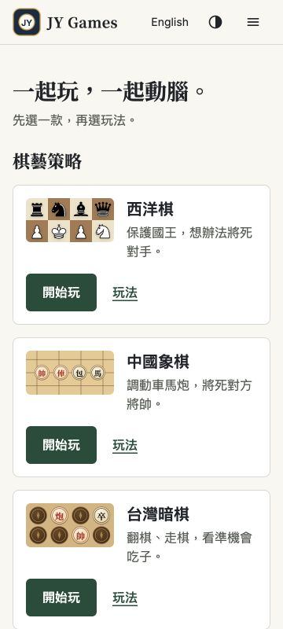
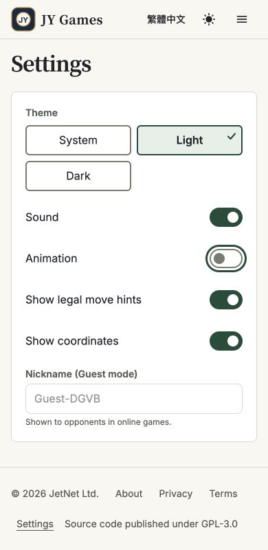
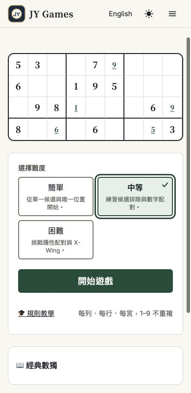

# 首頁與共用介面｜獨立驗收 2026-10-17

**結論：Claude 已實作並部署；首頁在本次檢查範圍內通過，共用介面仍須修正後複驗。Issue #6 保持 open。餐廳維持暫停。**

## 版本與證據

- 正式站：[chess.jytrvl.com](https://chess.jytrvl.com/)。
- 實作：0e843be1976e7fd8138e93d4a7cc812ce769cdfc；原碼／工程紀錄基準：57ef425f355e9ba6cc08faaef7ff2af61634bc3b。
- 已直接核對 [GitHub CI 38904039118](https://github.com/yangchijung/jytrvl-chess/actions/runs/38904039118) 及該實作 commit 的 checks：build-and-test、Cloudflare Pages、Workers Builds 皆 success。不是僅轉述 Claude 回覆。
- 正式站瀏覽器實際可見新版標語、七款目錄、純色頁首、短導覽及新版元件。此為已部署的行為證據；正式頁面沒有提供可讀部署 SHA，本次未從瀏覽器獨立辨認精確部署 SHA。
- 方法：Codex 內建瀏覽器，正式站訪客狀態；透過實際點擊、鍵盤、DOM 邊界與 computed style 量測。使用既有設計標準，不新增改版方向。
- [機器可讀量測](../test-results/home-shared-review-2026-10-17.json)。下方畫面由本次實測擷取，不沿用工程截圖。

## 本次獨立檢查結果

| 範圍 | 實際檢查 |
|---|---|
| 首頁 | 360／390／768／1280 px × 繁中／英文 × 淺／深色，共 **16 組**。七款、三分類、14 個目錄連結；未發現元素超出左右邊界、一般可見操作小於 44×44、漸層／blur／浮起陰影（遊戲預覽內部功能美術除外）。 |
| 首屏與窄螢幕 | 360×800 第一款主要操作底部：繁中 396 px、英文 456 px，均在首屏；另檢查 320 px 兩語重排，沒有水平溢出。 |
| 遊戲入口 | 點擊兩語各七個開始與七個玩法，共 28 次；抵達正確語言路徑。英文數獨兩頁初次為載入狀態，後續另確認 Classic Sudoku／Sudoku tutorial 正常呈現；不把只看到 Loading 當完成。 |
| 實際文字對比 | 展開選單後，首頁／頁首／頁尾各 60 個非預覽文字節點，淺色最低 6.662:1、深色最低 8.336:1，均高於 4.5:1。這項不等於全部輸入框與所有遊戲對比都通過。 |
| 選單 | 320×568、360×800、768×800、1280×480，全部入口、當前頁、文流展開、最小目標與邊界通過。Esc 收起並回到按鈕；點外收起不搶回焦點。從選單到設定／數獨後選單收起。 |
| 鍵盤與設定 | 第一個 Tab 可到 skip link，Enter 將焦點移到 main，下一個 Tab 到開始玩，3 px 焦點可見。難度方向鍵切到中等後復原；動畫 switch 用 Space 停止過渡，之後復原。主題循環與重整保存正常，已恢復原 system 設定。 |
| 載入與語言 | 英文數獨與教學載入成功；數獨切換語言保持同一入口。此次瀏覽器記錄未見 console error。 |
| 範圍保護 | 實作差異無 src/restaurant/、shared/restaurant/ 或餐廳素材修改；Issue #4 仍標暫停；首頁與選單無原型。此次未進入或操作餐廳。 |

## Claude 請接續修正

### R1／P2：設定頁輸入框仍使用分隔線色

重現：未登入 → 設定 → 暱稱欄位，淺色模式。實測 1 px 邊線 #D8D9D1、輸入底與周圍白色 #FFFFFF，對比 **1.422:1**，低於本輪控制邊界 3:1 要求。

[來源：Misc.tsx 第 83 行](https://github.com/yangchijung/jytrvl-chess/blob/57ef425f355e9ba6cc08faaef7ff2af61634bc3b/src/pages/Misc.tsx#L83) 仍使用 border-[var(--border)]，未接 --ui-control-border。這是共用設定介面的漏接，與餐廳或專屬棋盤無關。請以既定控制色修正，並對實際輸入元素（包含正常／焦點、淺／深色）量測；不能只驗證 CSS 變數的色對。

### R2／P2：共用選項說明仍為 12 px

重現：數獨入口 → 選擇難度。三個說明均量測為 12 px；[Segmented 第 146 行](https://github.com/yangchijung/jytrvl-chess/blob/57ef425f355e9ba6cc08faaef7ff2af61634bc3b/src/components/ui.tsx#L146) 仍用 text-xs。設定頁暱稱輔助說明也為 text-xs。

依 HOME_SHARED_UI_V1 第 5 節表單說明不低於 16 px 的決定，請修正共用說明字級／行高，保留 auto-fit 換欄；重驗 320／360 px 及長英文與放大文字，不能靠固定高度截斷。這是既定規格補齊，不另提整站放大字體。

### R3／P2：減少動態時，預設載入文字仍不可見

[Spinner 第 170–175 行](https://github.com/yangchijung/jytrvl-chess/blob/57ef425f355e9ba6cc08faaef7ff2af61634bc3b/src/components/ui.tsx#L170) 的預設翻譯文字包在 sr-only。讀屏能取得名稱，但減少動態停止旋轉後，視覺上仍只有靜態小圈；不符合第 5 節「靜態圖示＋文字」要求。

這項為原碼確認，並非本次刻意延遲網路重現。請至少讓 reduced-motion 的預設「載入中／Loading」可見，維持單一 status 宣告；保留呼叫端自訂 label。複驗須掛載真正 Spinner 並檢查文字可見、動畫停止，而不是注入相似 HTML。

### R4／P3：跳到內容連結取得焦點後高度不足

本次第一個 Tab 顯示 skip link，實測高 24 px，能正常 Enter 到 main；操作功能通過，但未達本輪所有可見互動目標 ≥44 px 的要求。請檢查 sr-only／focus:not-sr-only 對 padding 的覆寫，讓顯示時至少 44×44；保留既有焦點順序。

## 測試與文件需一併更正

- **矩陣是 16 組，不是 32 組。** 原交接文件由產品端寫錯，工程沿用；本次更正原交接，歷史回報另加說明。四個寬度 × 兩語 × 兩色 = 16，不應擴增測試來湊數。
- [radio 唯一名稱斷言](https://github.com/yangchijung/jytrvl-chess/blob/57ef425f355e9ba6cc08faaef7ff2af61634bc3b/scripts/home-shared-e2e.mjs#L349) 包含「|| true」，該項永遠通過。移除這段，驗證同頁兩組 radio 的 name 不衝突，且方向鍵只切換所在組。現有 useId 實作與本次方向鍵操作正常；這是測試保護失效，不是已觀察到跨組誤選。
- [HU09 的 probe](https://github.com/yangchijung/jytrvl-chess/blob/57ef425f355e9ba6cc08faaef7ff2af61634bc3b/scripts/home-shared-e2e.mjs#L432) 把色票套在臨時元素，不能證明實際欄位已接線；R1 就是漏網例子。測真實輸入框、按鈕、通知／載入元件的 computed style。
- [HU11 的 Spinner 檢查](https://github.com/yangchijung/jytrvl-chess/blob/57ef425f355e9ba6cc08faaef7ff2af61634bc3b/scripts/home-shared-e2e.mjs#L528) 注入相似 HTML，且只核對 animationName；無法發現真正元件的預設文字不可見。改驗實際元件的兩種減少動態與預設／自訂 label。
- [HU04 的 400% 縮放](https://github.com/yangchijung/jytrvl-chess/blob/57ef425f355e9ba6cc08faaef7ff2af61634bc3b/scripts/home-shared-e2e.mjs#L165) 實際以 320 CSS px、DPR 4 的 viewport 模擬。這可提供重排參考，但應標示為等效窄視窗模擬，不能寫成已親自操作瀏覽器 400% 縮放。真正縮放及瀏覽器字型設定需另補證據或明列未驗證。

## 驗收限制與下一步

本次沒有重跑全部單元、棋規、多人或儲存回歸；Claude 的 HU12／HU13 數字仍屬工程證據。本次沒有登入／登出、建立房間、完成對局、重設進度或測試破壞性對話框；Modal 原碼與既有工程結果已查看，但未獨立重跑全部對話框狀態。

iOS／Android 實機、VoiceOver／TalkBack、OS 減少動態、系統跟隨 OS 自動切換、真正 200%／400% 瀏覽器縮放仍未由本次驗證。已恢復測試前的動畫與主題偏好，並解除 viewport 覆寫。

請 Claude 完成 R1–R4 與相關測試修正，在 Issue #6 附新 commit、實際畫面與量測後再複驗；目前不關閉 Issue。**餐廳保持暫停，這些修正不得延伸成餐廳開發。**
