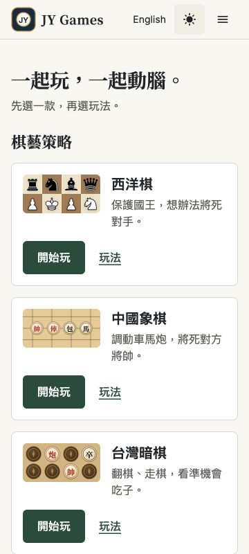
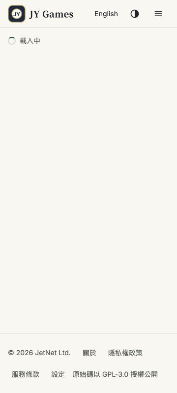
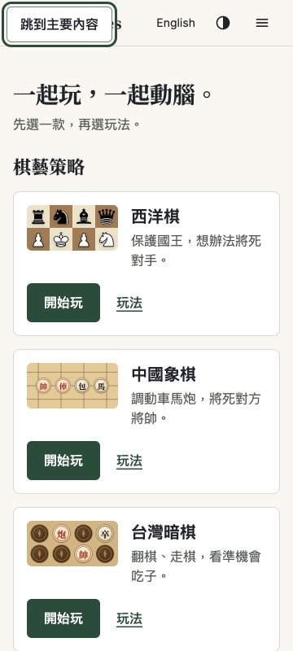

# 首頁與共用介面複驗｜2026-10-18

## 結論

**R1–R4 四項修正通過本輪複驗。** 正式站首頁 16 組響應式檢查及共用選單抽查通過，未發現本輪新增阻擋問題。餐廳維持暫停。

Issue #6 的四項修正不再列為待開發；Issue 保留 open 追蹤尚未完成的真實 400% 瀏覽器縮放、實機與讀屏驗收，不能將本輪結論擴大為全站已通過無障礙認證。

- 原碼基準：`af263b994ca5d72af9c021e655f4fd49c731b6d9`；功能修正：`63b4b139ee9218ba58059d80ddbde28000f5df89`。
- 已直接查核功能 commit 的 build-and-test、Cloudflare Pages、Workers Builds 皆 success。[CI](https://github.com/yangchijung/jytrvl-chess/actions/runs/39039108514)
- 正式站：[chess.jytrvl.com](https://chess.jytrvl.com)。本站畫面未提供部署 SHA，不能由畫面獨立證明精確 commit；本次確認的是修正後的實際行為與部署 checks。
- 本輪量測：[JSON](../test-results/home-shared-review-2026-10-18.json)。環境：Codex 內建瀏覽器；CSS viewport 由瀏覽器尺寸能力設定。

## 四項正式站實測

| 項目 | 本輪觀察 | 結果 |
|---|---|---|
| R1 設定頁輸入框邊線 | 淺色 #767C72／#FFFFFF = 4.289:1；深色 #8C9D8F／#202722 = 5.335:1；鍵盤焦點皆 3px 實線，焦點對比 9.629／9.296:1 | 通過 ≥3:1 |
| R2 共用說明字級 | 設定頁暱稱說明 16px／24px；數獨三個難度說明中英皆 16px，英文行高 24px；設定與數獨英文頁 320、360px 無元素超出主內容邊界 | 通過 |
| R3 載入提示 | 正式站開啟數獨教學、站內動畫關閉時，真實 Spinner 單一 status，文字「載入中」可見，66×20px，動畫名稱 none；英文數獨載入也觀察到 Loading | 通過 |
| R4 跳到主要內容 | 繁中 360px：130×44px；英文 1280px：188.5×44px；第一個 Tab 可聚焦，繁中 Enter 到 main，下一個 Tab 到 play-chess | 通過 |

R3 沒有注入假元件或延遲正式站網路。自訂 label 的保留由原碼核對；一般旋轉與 OS 減少動態的成對驗證採工程本機 HU-R 證據，本輪另獨立驗證站內減少動態。不要把工程測試記成產品端重跑。

## 首頁與共用層

- 360／390／768／1280 × 中英 × 淺深，共 **16 組**。每組七款、三分類、14 個目錄連結；無主內容元素超出視窗，文件寬等於 viewport；首頁主要按鈕皆至少 48px 高。
- 360×800 第一款開始玩底部：繁中 396px、英文 456px，均在首屏。
- 首頁無餐廳／機器人／逆風／救援原型入口。
- 英文選單於 360×800、768×800、1280×480：12 個連結＋登入控制，目標皆至少 44px 高；展開時 header 為 relative；Esc 收起並回焦點。
- 西洋棋設定頁同頁兩組 radio 的 name 不同；ArrowRight 僅讓難度 easy → medium，我方保持 first，再 ArrowLeft 還原。沒有開始對局。
- 另抽查西洋棋房號輸入框使用新邊線、3px 焦點；語言切換保持設定／數獨等價頁。
- 本次捕捉到的瀏覽器 console error 為 0。此數字只涵蓋本次操作。
- 測後主題還原 system、動畫還原開啟，並解除 viewport 覆寫。未改暱稱、登入、建立房間、開始新遊戲、重設進度或操作餐廳。

## 工程證據核對與限制

已讀修正原碼與腳本：radio 的永真 `|| true` 已移除；HU-R 改量真實欄位、真實路由 Spinner；縮放標示已明確區分重排模擬。工程回報 14／14 與必要遊戲回歸仍屬工程執行證據，本輪沒有再次執行全套。

小型文件落差：腳本 HU03 已寫 16 組，但已提交的 `home-shared-e2e-local.json` HU03 名稱仍殘留「(32)」。本次獨立矩陣確為 16，這是舊輸出文字未同步，不是另有 32 組測試；保留工程原始輸出，下次產出時更新。

仍未獨立驗證：真實瀏覽器 400% 縮放、瀏覽器內建字級設定、實機 iOS／Android、VoiceOver／TalkBack、OS 偏好切換、登入三種狀態、完整 Modal 流程與全部遊戲回歸。本次沒有重新逐一點擊 28 個首頁連結；前輪紀錄保留，不計為本輪新測試。方塊遊戲內操作與兒童原型專屬介面依原計畫另列，餐廳不重啟。

## 現場截圖

