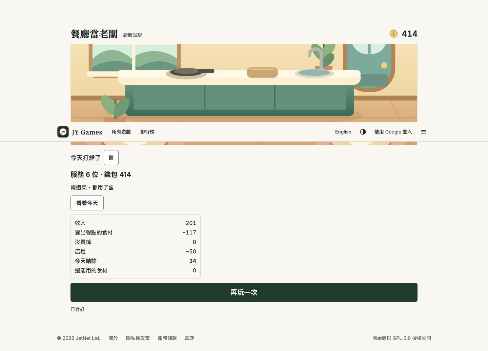
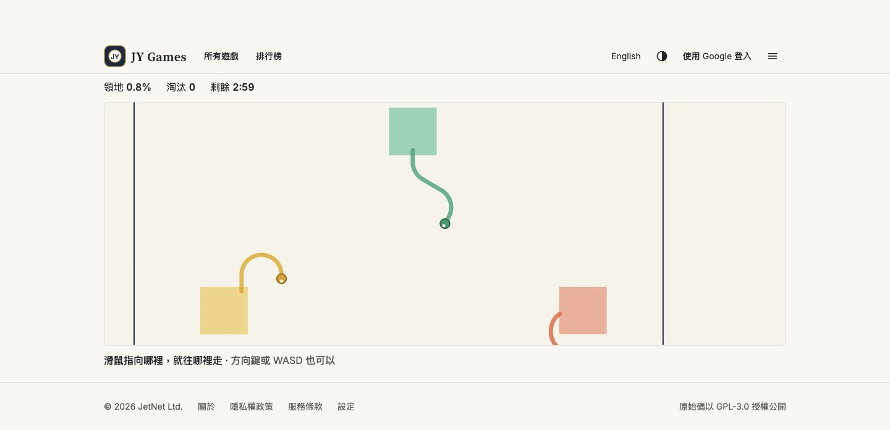
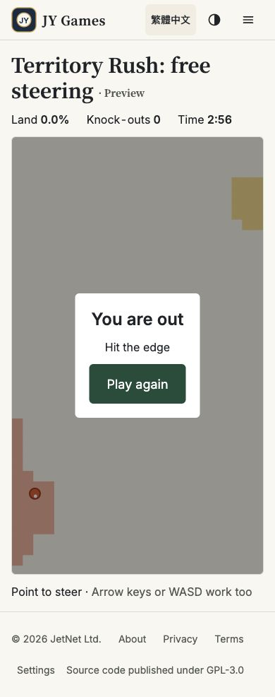

# 餐廳存檔與領地連續轉向：產品複驗

日期：2026-10-19（Asia/Taipei）。原碼基準：`83d0cca05c10dede67d6e049b40cefcea94d7361`。

## 結論與接續工作

- **餐廳原 R3-S1 回蓋問題通過本輪回歸；擴充檢查另發現 R3-S2／R3-S3，尚不能宣告多分頁全部通過。** Claude 已交付 R1-b 完整一天，不必重新派做 R1-a。保留已交成果，先補兩個存檔邊界，再收尾完整一天的其餘驗收。
- **領地 T1 第一版已交；連續角度、等速、轉彎與基本圈地／碰撞在已測範圍內通過，可接 T2。** 手機版面檢查不等於實機觸控驗收，正式線上入口仍待 T3。
- 餐廳已恢復開發；/restaurant 與 /territory/flow 保持 noindex 預覽、不加首頁。本輪不恢復逆風探險賽，不改其他工作範圍。

## 交付查核與測試邊界

已讀 AGENTS.md、DESIGN.md、STATE.md、兩份產品規格及 ACCEPTANCE.md §23.1／§23.2／§24。

| 交付 | 查核 |
|---|---|
| 餐廳跨分頁修正 | f694161：base 原文比對＋Web Locks |
| 餐廳 R1-b | baf96ef：完整六客、替代／缺料、重玩紀錄與 classic 保護 |
| 領地 T1 | dfa0568：獨立 /territory/flow 本機預覽 |
| CI | 已直接查 GitHub：餐廳 [39272395754](https://github.com/yangchijung/jytrvl-chess/actions/runs/39272395754) 與領地 [39274370361](https://github.com/yangchijung/jytrvl-chess/actions/runs/39274370361) 均 completed／success |

本輪產品端自行執行：Chrome 正式站 UI 操作、兩個餐廳分頁；原診斷 17／17；新增隔離診斷 12 組中 10 過、2 失敗。隔離診斷以該 commit 的精確 TypeScript 原碼移除型別，使用記憶體儲存、可控跨上下文交錯與排隊鎖替身。**不是正式瀏覽器故障注入，也不是完整 npm test／typecheck／build 重跑。** 工程報告中的全套數量仍屬工程證據。

## 餐廳：實際雙分頁與完整一天

本輪接續上次產品端自己的 V3 測試局（已服務兩客、現金 450、等待第三客），沒有清除／注入正式站存檔。

1. B 做第三份番茄飯，A 收到另一分頁通知：成品保留；A 點米放入鍋子草稿，不扣料、不吃掉成品；B 重整保留。
2. B 連點送餐只收一次，450 → 482，進第四客；A 同步。接著分別於 A、B 做菜送餐：517 → 549 → 最後收款扣店租後 534。
3. A 重整仍服務六位；「看看今天」顯示收入 201、賣出食材 117、沒賣掉 0、店租 50、結餘 34、剩料價值 0。
4. A 預覽盆栽，B 重整保留預覽；B 取消仍 534，A 同步。再預覽、連點買 120，只扣一次到 414。
5. B 重整仍 414、盆栽在、六位已服務。

原診斷 17／17 包含原「舊分頁草稿覆蓋餐點／收款」兩例、三組完整一天純規則數值、重送動作、防重複付款、壞檔／備份／讀回與 quota。新增測試也確認：排隊 Web Locks 拒絕舊 base 寫入；重玩保留六客、結餘 34、期末 414、裝飾 120 的上一局摘要；classic 原文與備份失敗路徑保留。

**產品端本輪未重新走完只番茄／番茄＋吐司的實際畫面、缺料／進階入口／重玩完整 UI；這些目前有工程證據與部分純規則回歸，不冒充本輪 UI 驗收。**

### R3-S2（P1）：無 Web Locks 的讀寫交錯仍會回蓋

位置：`src/restaurant/v3.ts:168–228`。沒有鎖時直接 `run()`，讀取、比較與寫回不是跨分頁原子操作。

隔離重現：

1. A、B 從相同採買後存檔 N 開啟。
2. A 讀取 N 以更新鍋子草稿；在 A 寫回前，B 做菜並提交 N+1（成品 1、蛋 5）。
3. A 按已讀到的 N 判斷 base 一致，寫回自己的舊狀態。
4. 實際磁碟成品變 0，預期仍 1；B 的做菜結果被蓋掉。

測試 S2 用儲存替身在 A 的 getItem 與 setItem 之間安排 B 提交，模擬兩個上下文；**未宣稱實際 Chrome 的 Web Locks 失效**。此外 `locks.request(...).catch(run)` 也會無鎖降級，該拒絕分支為原碼發現，本輪未另觸發。

修正要求：沒有／無法取得跨分頁鎖時使用可證明的安全協調或交易方案，或明確限制其他分頁寫入；不能把同樣的無鎖 read-check-write 當成保護。保留孩子未存進度與明確提示，不假報已存好。補無鎖、鎖請求失敗及同時做菜／付款／草稿的交錯測例。

### R3-S3（P2）：延遲舊通知讓 UI 退回舊金額

位置：`src/restaurant/v3.ts:141–149`。onStorage 對任何與 base 不同的有效 newValue 都直接採用，未確認是否仍是目前儲存內容。

隔離重現：

1. B 做菜，留下尚未送達 A 的 storage 通知（現金 383、有成品）。
2. A 更新草稿時偵測衝突，先採用 B 的新局。
3. A 送餐，畫面與磁碟都 415。
4. B 先前的通知延遲到達，A 的 UI 又顯示 383、餐點回來；磁碟仍是 415。

這是**UI 與磁碟不一致**，不是已證實磁碟付款遺失；下一次提交的 base 檢查仍有保護。Web Locks 並未涵蓋此通知處理。

修正要求：把通知當成重新讀取／同步的信號，採用當下有效存檔或一致的版本判定；不能無條件套用舊事件快照。補「先同步 → 本地付款 → 舊通知才到」測例，確認現金、客人、成品、鍋子及已存狀態一致。不要只用可能跨新局重置的 seq 大小判斷。

## 領地：T1 已測範圍

實際網址：[連續轉向預覽](https://chess.jytrvl.com/territory/flow)／[英文](https://chess.jytrvl.com/en/territory/flow)。

- Chrome 實際移動指標並點擊場地，DOM 顯示約 30.35°、119.45° 目標角度；角色朝目標連續轉彎，畫面出現弧形尾線。不是四／八向量化。
- 方向鍵 Up 的目標為 -π/2，角色逐步轉向；未把測試工具無法用 locator 聚焦 canvas 的失敗算成產品問題。
- 390×844 中英版面：document clientWidth／scrollWidth 均 390，沒有水平溢出。**這是桌機瀏覽器窄視窗，不是手機觸控實測。**
- 精確原碼六組檢查：0／30／45／120° 等速（六步距離 3）；每步最多轉 13.5°；非法角度／玩家拒絕；斜線繞圈回家新增領土、尾線清空；穿過自己的舊線／撞牆判負；同種子及輸入可重現。

限制：本輪指標控制使用實際定位加點擊；雖然原碼 pointermove 不要求按住，**沒有獨立完成「只 hover、不按鍵」測試**。未測 iPhone／iPad Safari 觸碰不拖即轉、拖曳／放開／pointercancel／多指、VoiceOver、真實 30／60／120 Hz、同機雙人、頭碰頭、回家接縫及線上重連；工程的測試結果不替代這些產品／實機驗收。

### T2-P1（P2）：補背景暫停與返回計時

原碼發現：`src/territory/flow-page.tsx:71–95` 無 visibilitychange 暫停；第 81 行將長時間差限制為 250ms，回來仍可能補跑五步（2.5 格），不等於背景暫停。需保留既有本機玩法的背景暫停語義，處理倒數及進行中，返回重設 last／acc、不補跑隱藏時間。

本輪工具切頁後 DOM 仍回報 visible，無法造成真正 hidden；**此項是原碼發現與待驗證要求，沒有宣稱正式站已重現或通過背景切換。**

Claude 請直接接 T2：背景暫停、連續 AI、圖片式教學、同機雙人輸入隔離與斜線／轉彎碰撞邊界，補中英手機與觸控證據。接著 T3 才做線上權威／協定／快照／重連相容，通過後再替換正式入口。保持原創美術及 DESIGN.md，文字只留必要短提示。

## 證據與重跑

- [原 17 項結果](restaurant-territory-2026-10-19/baseline-results.json)，原腳本沿用 [上輪 audit.mjs](restaurant-r1a-2026-10-19/audit.mjs)。
- [新增 12 項結果](restaurant-territory-2026-10-19/extended-results.json)。
- [新增診斷腳本](restaurant-territory-2026-10-19/extended-audit.mjs)：Node 24，從 checkout 執行：
  `node docs/design/restaurant-territory-2026-10-19/extended-audit.mjs . /tmp/restaurant-territory-result.json`
  第四參數可填被測 commit SHA；未填標 working-tree。存在失敗時 exit 1，這是預期現況。
- 這份報告及 Issue #4／#8 的新留言為產品端交接；不代表 Claude 已讀取或已開始處理新缺口。
