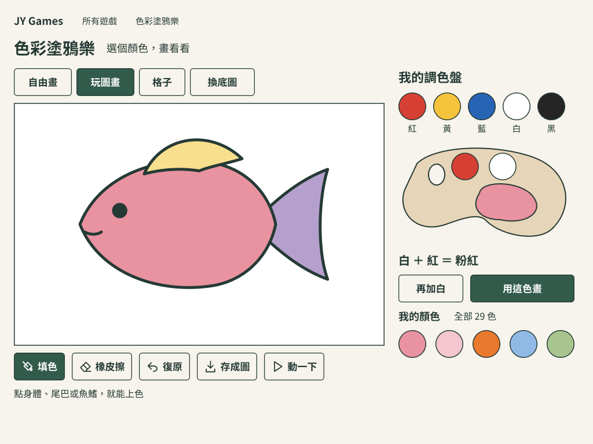
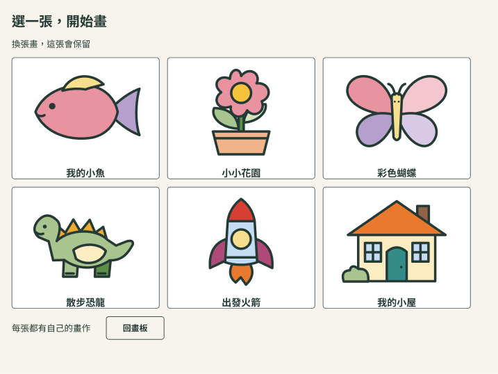
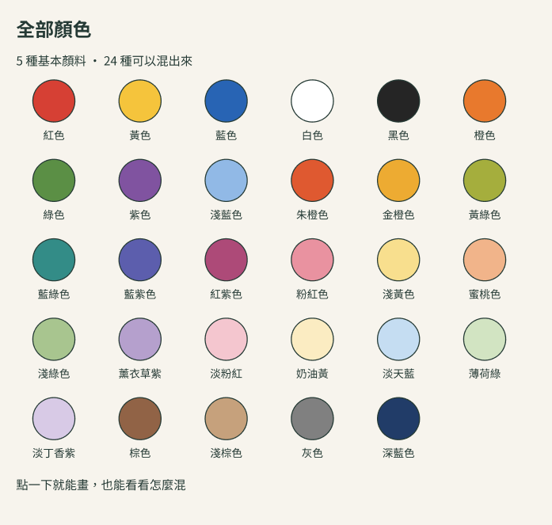

# 色彩塗鴉樂 V2 設計與線稿

[執行規格](../../product/DOODLE_WORKBENCH_V2.md)｜[配方資料](../../product/doodle-palette-v2.json)｜[Figma 可編輯原稿](https://www.figma.com/design/8DZPVdappd79RgFzzBzH6K)

## 設計稿

- [平板畫板與調色盤](https://www.figma.com/design/8DZPVdappd79RgFzzBzH6K?node-id=2-2)：workbench-tablet.png
- [六張底圖](https://www.figma.com/design/8DZPVdappd79RgFzzBzH6K?node-id=2-85)：templates-six.png
- [手機可捲動頁](https://www.figma.com/design/8DZPVdappd79RgFzzBzH6K?node-id=2-155)：workbench-phone.png
- [完整 29 色](https://www.figma.com/design/8DZPVdappd79RgFzzBzH6K?node-id=4-20)：palette-29.png

PNG 是 Figma 設計畫面，不是上線、程式或實機驗收截圖。平板稿展示混色後狀態；初始兩槽與「混一混」、錯誤／保存／完整鍵盤行為以規格為準。近期色點需加可讀名稱與選取狀態，「全部 29 色」必須實作為可聚焦控制，不能只畫文字。

## 原創線稿

line-art/*.svg 與 templates.json 是同一組 400×300 可編輯向量資料：6 張、32 區域。白底線稿供新作品；彩色設計預覽僅展示用色，不覆蓋孩子的畫。

- fish：沿用 repo shared/doodle/scene.ts 的 FISH_ART 三區域輪廓與 ID，整理線條／眼睛細節。
- garden／butterfly／dinosaur／rocket／house：2026-10-20 由產品端原創路徑，在 Figma 組稿、目視核對；不是競品角色或素材。
- 固定細節在 SVG 最上層；只有 data-region 的封閉路徑可填色。templates.json 區域順序是繪製順序；accessibleOrder 是替代操作順序。
- 介面使用 Noto Sans TC，設計輸出未附帶字型檔；工程沿用 repo 字型與授權流程。
- 無新增付費素材、第三方圖片、照片或帳號服務。源碼與美術沿 repo 現有授權管理，工程整合時補 docs/LICENSES.md 的來源紀錄。

validation.json 只記資料計數／可達性、舊色保留、加白亮度方向與本輪檢查範圍；不冒稱物理顏料準確、正式 UI 已接線、保存遷移或孩子試玩通過。
