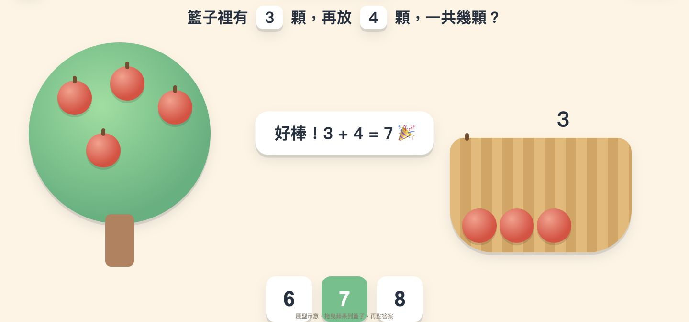
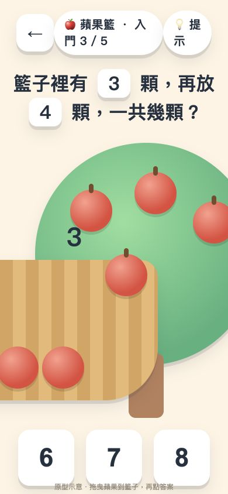

# 數學遊樂島附件審查｜2026-10-20

結論：來源已補齊；適合作為玩法草圖與規劃來源，尚未達可交孩子驗收的 M0。Claude 可依整合後主規格繼續 M0-A／B，不等待再次確認開工。

## 1. 來源與查核範圍

James 提供外部 `HANDOFF_CLAUDE.md` 與 `math-games.zip`。外部交接與 ZIP 內同名檔逐位元相同。ZIP SHA-256：

`0cc03757777eec6034e320109e6c5324263d2b68b76c6e95f40b2d39ea01de87`

已讀三份 Markdown、四份 HTML／CSS、截圖腳本及四張原截圖；附錄 A 已在 `開發規格書_v1.md` 末段，不再列為缺件。原稿是待審資料，不會因其中寫了「執行」就變成新的派工授權。

另外透過本機 HTTP 開啟原始 `proto/apple.html`，在桌機 Chrome 實際點選及檢查 768×1024、390×844 視窗。沒有修改原型、沒有部署、沒有執行附帶的 `shot.py`。不是實機 iPad／Safari／VoiceOver 或孩子試玩驗收；也未量測 FPS。

## 2. 原型待修清單

| ID | 證據與重現方式 | Claude 完成條件 |
|---|---|---|
| MR01／高 | 蘋果初始籃內 3 顆，尚未搬動樹上的 4 顆，按答案 7 即出現成功。瀏覽器已重現；程式僅查 `data-ok`。 | 正式 M0 的教具操作完整且數量正確後才能完成題目；判答依遊戲狀態，不依按鈕標記。未完成時提供中性提示，不判數學答錯。未搬、少搬、重複點答、重來皆測。 |
| MR02／高 | 返回按鈕無處理；提示只是文字；沒有重來、下一題、點 A 點 B、蘋果鍵盤操作、朗讀或保存。小魚與地圖均為靜態示意。 | 依主規格完成五題、替代操作及續玩；每個顯示的控制可用，不把截圖上的星星／進度當真實資料。 |
| MR03／高 | 768×1024 樹與籃重疊；390×844 籃子左側與樹右側被裁切。CSS 全頁 `overflow:hidden`、`touch-action:none`，不符合縮放與窄畫面要求。 | 場景依可用空間重排，數量完整可數、操作可達；保留瀏覽器手勢。於規格尺寸與縮放實測；桌機尺寸檢查不可代替實機。 |
| MR04／高 | 原碼每顆蘋果各自接受 pointerdown，無共用活動 pointer、pointercancel／lost capture；以籃子共用 `.hot` 判斷放手，且容錯是四邊各加 48 的矩形。這是原碼缺口，未宣稱實測多指成功或失敗。 | 實作統一放置規則：單指、取消回復、放手即時計算物件中心至目標區域距離、47／48／49 邊界、多目標歧義；可拿回。 |
| MR05／中 | `apple.png` 與 `apple-done.png` 位元組完全相同。頁面從無 hash 導航到 `#done` 時仍顯示 3；重新載入 `#done` 才變 7 並成功。已實測。 | 截圖流程以新的頁面載入指定狀態並先斷言可見結果。正式完成必須走真實遊玩流程；`#done` 示意不得算通關、寫入進度或代替驗收。 |
| MR06／中 | 原截圖及 CSS 包含漸層、明顯陰影、膠囊標籤、emoji、錯答搖晃；與現行 DESIGN.md 不合。 | 保留可數物件／目的地與短任務的構圖，改用受限實色、清楚輪廓與原創素材；120–220ms 因果動作，減少動態時直接定位。 |

MR01 桌機實測：

MR03 桌機 390×844 視窗：

原圖兩檔共同 SHA-256：
`ff6454d35a4c29e31ce6d2b4c293088f892785a9e1499a61ffcd731ab094de5c`

## 3. 文件衝突的處理

| 主題 | 原始來源 | 整合後採用 |
|---|---|---|
| 營收 | DEV_SPEC 與 v1 §11 訂閱／買斷／學校授權 | 最新交接全免費、無廣告，移除付費開發與商業待決項。 |
| 技術與部署 | 舊 Unity／Flutter、新開 math-island 靜態站、再建骨架 | 既有 chess 站 Vite／React／TS 加 `/math` 模組，PR 預覽；PixiJS 按場景需要選用，不另建完整站。 |
| 起始年級／首批 | 舊一年級或一二年級；v1 P0 蘋果＋披薩 | 延續已交接 M0 蘋果＋分裝，之後六款含披薩；這是產品排序，不宣稱來源本來就是分裝。 |
| 蘋果語意 | 原型「已有 3 顆，再放 4 顆」；M0「兩堆合在一起」 | M0 先兩堆合成且保留來源組別；來源的添加情境可留後續獨立題型。不要同題混用說明與教具。 |
| 設計／單位 | 24／48pt、≤400ms、陰影、彈回、多色 | 現行 DESIGN.md 與主規格；吸附 48 CSS px，不乘 DPR；目標 56／64 CSS px、間距 16；120–220ms。 |
| 追蹤與資料 | v1 §8 PostHog、帳號與推播；原交接隱私句意不明 | 不加第三方追蹤。M0 匿名單機，不需孩子真名、Email、生日；正式帳戶與同步仍待決。 |
| 難度／精熟 | 8 題起點、連對升級、作答速度低於年級中位數、提示打八折 | M0 五題固定，不裝自適應；後續先由老師確認指標。不把閱讀／操作速度或使用朗讀當不理解的證據，不自動給用提示者扣掌握度。 |
| 時限／連續登入 | v1 乘法限時、附錄連續天數加成 | 主學習流程無強制限時，不做連續登入獎勵；未來自選挑戰另列需求。每日上限仍待 James 決定。 |
| 驗收 | 3 或 5 位孩子、80%、50 或 60fps、多種載入秒數 | 本批以主規格 MA01–MA10 定義為準；三位逐人記錄，不把 2/3 說成 80%；效能與實機項不能憑截圖打勾。 |
| 法規與上架 | 舊稿寫「符合」及雙商店上架 | 目前是網站預覽，不代表法務審閱或商店審核已完成；若後續上架另核當時規範。 |

原稿的家庭姓名與年齡不作公開交接內容；兩份草案年齡記載不同，也不據此作產品年齡分流。家庭測試用匿名 A／B／C 與實際適合程度。

## 4. 課綱與教學用語

原稿自述課綱表未核定，不能整表當成完整覆蓋。已對照官方課綱原文：

- v1 開頭「R 第二學習階段起」需更正：第一學習階段已有 R-1-1 算式與符號、R-1-2 加法次序。
- 三年級 D-3-1 是一維／二維表格；長條圖、折線圖的報讀與長條圖製作在 D-4-1。原三年級「投票站」若保留，先改成整理表格；長條圖版放四年級，或明標跨年級延伸。
- `N-2-?` 是占位符，不能進正式題庫或宣稱已對齊課綱。每題需完整代碼、範圍與獨立答案驗算；`answer: "a+b"` 不當作可執行程式碼。
- 後續名稱「分數調酒師」改「分數果汁吧」，保留分配與混合概念。
- 「玩完就懂」、留存率與遊玩時間不是理解的證據。試玩先記孩子能否完成操作、說明數量關係及需要何種協助。

依據：[教育部數學領域課綱原文，公立學校鏡像](https://www.bdsh.ntpc.edu.tw/app/index.php?Action=downloadfile&cg=821&file=WVhSMFlXTm9MelkwTDNCMFlWOHhORGxmTlRJM016UXpNbDh5TnpBME1TNXdaR1k9&fname=LOGGYSOKWW10111050LKSXHGKO30A1LODGJCDC10QPJDXW40A0TSGHSWWWOO50OKPOCCEH10A40435XTSTKOTSMOKL34QLNOXTYTXWA0LKA4JG50FHHGB5PK44POCC11HCA0UWIGZSDG40YSUSB0MOIC4435QPROA0DCECFGGGSWYSUSUSQODH05NOFG41ZWTWB4MK2520ROB1MO21MPROVSKPB4NKPOPKKKFCTWYWCC4115LOEGFCYWQODGA1A1FGB0YS20A1RLA0VSKPNO1145)，印刷頁 20、26、29（PDF 第 23、29、32 頁）。這是上述項目的產品查核，不是六年級全表或教學顧問簽核。

## 5. 銀行附錄已讀，但未定稿

保留島幣、徽章、家長自訂獎勵與核准、活存／定存、存錢目標、家庭旅行基金方向。原稿的週息 1%、2／4 週、300／1000 島幣獎勵、隨機果園／漁船報酬是草案值，不自動成為正式設定。

M2 實作前要具體定義：誰能核准；申請是否預留餘額；核准時餘額不足、撤回、重複核准；存款、投資與目標是否可同時計同一筆本金；取整、時區、結息時間、離線補算、提前解約、裝置改時間、多分頁與重送如何保持交易唯一。旅行基金到期自動轉入也需明確同意與帳目規則。

原稿一面禁止抽獎，一面設定機率收益，兩者產品邊界尚未說清楚。先保留為後續教學提案，另定資訊揭露、可承受損失、回饋與無重抽誘因；M0 不實作銀行或隨機報酬。三年級可理解分配取捨，不等於百分率與複利公式屬三年級必修。

## 6. 下一批交付

1. Claude 依整合主規格做 M0-A，優先解 MR01–MR04，交五題可玩流程與 PR 預覽。
2. M0-B 接分裝工廠、保存／語音完整流程與正式素材。
3. 每批附程式 commit、預覽網址、逐項實測與未測；ChatGPT 核對、James 合併。
4. 原 prototype 只作參考，修正在正式模組進行，不必先修兩套系統。四款停止的遊戲不恢復。
